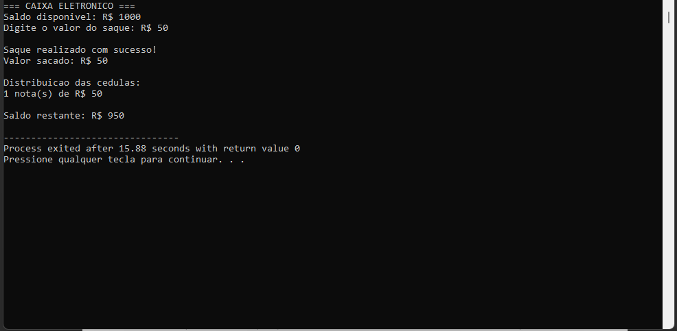
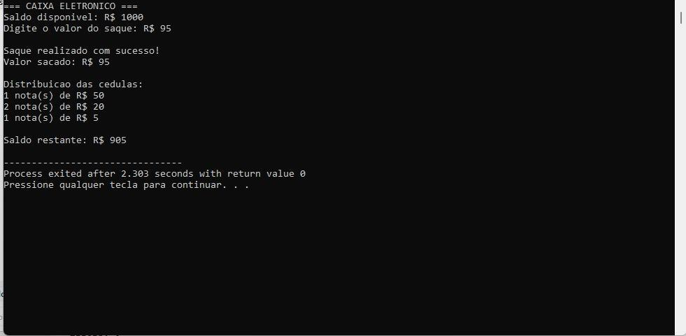
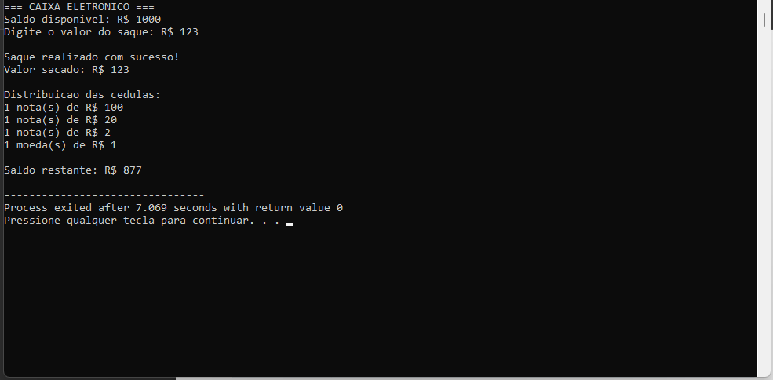
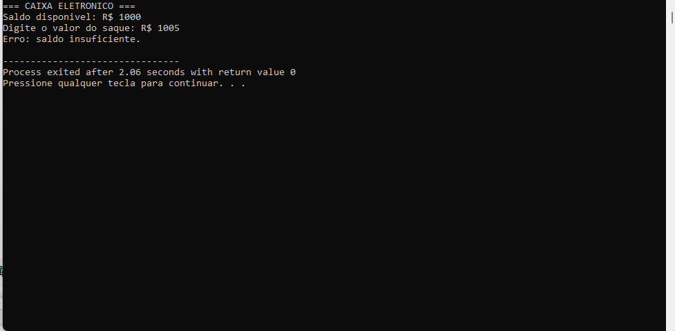

# 🏧 Caixa Eletrônico em C

Simulação de um caixa eletrônico simplificado em linguagem C, desenvolvida como atividade acadêmica (Atividade 02 – Grupo 05) do curso de Engenharia de Software.

O programa recebe um valor de saque, valida o pedido e calcula a **menor quantidade de cédulas** necessária para entregar o valor, atualizando o saldo da conta ao final.

---

## ✨ Funcionalidades

- Saldo inicial fixo de **R$ 1.000** a cada execução
- Validação de entrada:
  - rejeita entradas que não são números inteiros
  - rejeita valores menores ou iguais a zero
  - rejeita saques acima do saldo disponível
- Distribuição em ordem decrescente de cédulas: **R$ 100, 50, 20, 10, 5, 2** e **moeda de R$ 1**
- Exibe apenas as cédulas efetivamente utilizadas
- Mostra o saldo restante após o saque

> Como existe moeda de R$ 1, **qualquer valor inteiro positivo** até o limite do saldo pode ser sacado — não é preciso exigir múltiplos de 2 ou 5.

---

## 🧠 Lógica utilizada

O cálculo usa um algoritmo guloso com **divisão inteira (`/`)** e **resto da divisão (`%`)**:

```c
nota100  = restante / 100;
restante = restante % 100;

nota50   = restante / 50;
restante = restante % 50;
// ... e assim por diante até a moeda de R$ 1
```

Sequência lógica:

1. Declarar saldo, valor do saque, valor restante e contadores de cada cédula
2. Ler o valor inteiro do saque
3. Recusar valores `<= 0`
4. Recusar valores acima do saldo
5. Calcular as cédulas da maior para a menor com `/` e `%`
6. Exibir somente as cédulas com quantidade maior que zero
7. Subtrair o valor sacado do saldo e mostrar o saldo restante

---

## 📁 Estrutura do repositório

```
caixa-eletronico-c/
├── src/
│   └── caixa_eletronico.c       # Código-fonte em C
├── pseudocodigo/
│   └── caixa_eletronico.por     # Algoritmo em Portugol (Portugol Studio)
├── docs/
│   ├── relatorio_testes.pdf     # Relatório com objetivo, variáveis e testes
│   └── img/                     # Capturas de tela das execuções
└── README.md
```

---

## ▶️ Como executar

### Linux / macOS / WSL

```bash
gcc src/caixa_eletronico.c -o caixa_eletronico
./caixa_eletronico
```

### Windows

Com o [MinGW](https://www.mingw-w64.org/) instalado:

```bash
gcc src/caixa_eletronico.c -o caixa_eletronico.exe
caixa_eletronico.exe
```

Ou abra o arquivo `src/caixa_eletronico.c` em uma IDE como **Dev-C++** ou **Code::Blocks** e compile/execute normalmente.

### Pseudocódigo

Abra `pseudocodigo/caixa_eletronico.por` no [Portugol Studio](https://univali-lite.github.io/Portugol-Studio/).

---

## 🧪 Testes realizados

| Entrada    | Resultado esperado                                    | Saldo final |
|-----------:|-------------------------------------------------------|------------:|
| R$ 50      | 1 nota de R$ 50                                       | R$ 950      |
| R$ 95      | 1 × R$ 50, 2 × R$ 20, 1 × R$ 5                        | R$ 905      |
| R$ 123     | 1 × R$ 100, 1 × R$ 20, 1 × R$ 2, 1 moeda de R$ 1      | R$ 877      |
| R$ 1.005   | ❌ Erro: saldo insuficiente                           | R$ 1.000    |
| R$ 0       | ❌ Erro: valor de saque inválido                      | R$ 1.000    |
| `abc`      | ❌ Erro: digite um número inteiro                     | R$ 1.000    |

### Exemplo de execução

```
=== CAIXA ELETRONICO ===
Saldo disponivel: R$ 1000
Digite o valor do saque: R$ 123

Saque realizado com sucesso!
Valor sacado: R$ 123

Distribuicao das cedulas:
1 nota(s) de R$ 100
1 nota(s) de R$ 20
1 nota(s) de R$ 2
1 moeda(s) de R$ 1

Saldo restante: R$ 877
```

<details>
<summary>📸 Capturas de tela</summary>

**Saque de R$ 50**


**Saque de R$ 95**


**Saque de R$ 123**


**Saque de R$ 1.005 (saldo insuficiente)**


</details>

---

## 🛠️ Tecnologias

- **C** (padrão ANSI, biblioteca `stdio.h`)
- **Portugol** (pseudocódigo)

## 📚 Conceitos praticados

`variáveis` · `entrada e saída (scanf/printf)` · `estruturas condicionais (if / else if / else)` · `operadores aritméticos` · `divisão inteira e módulo` · `validação de entrada`

---

## 👥 Autores

Trabalho desenvolvido pelo **Grupo 05** – Engenharia de Software, UNICID.

<!-- Adicione aqui os nomes/GitHub dos integrantes, por exemplo:
- [Davi Guimarães](https://github.com/seu-usuario)
-->
